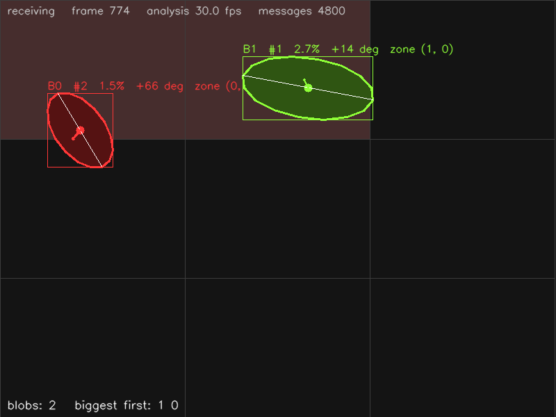

# Blobs — Python

_Castellano:_ recibe por OSC los *blobs* (formas que se destacan del fondo,
típicamente personas vistas desde una cámara en el techo) que manda
`mediapipe_osc.py --blobs`: contorno, caja, centro, velocidad, área y ángulo de
cada uno, y divide el piso en una grilla 3×3 para saber en qué zona está cada
visitante.  `python blobs.py` (y en otra terminal
`python ../../mediapipe_osc.py --blobs`, con la escena vacía al arrancar).

Receives the **Blobs** detector (`/mp/blob/...`) and draws every blob: its
16-point outline, bounding box, centroid, velocity arrow, main axis, area (as
% of the picture), orientation and id, plus its rank by size (from
`/mp/blobs`).  The picture is divided into a 3 × 3 grid of zones: the cells
that contain a blob light up and a change of zone is printed as an event — the
usual "something happens where the visitor stands" logic.



## Install

```
pip install python-osc opencv-python numpy      # or: pip install -r ../requirements.txt
```

## Run

```
# terminal 1: the camera (ceiling camera; start it with the scene EMPTY: the first
# frames are learned as the background.  Press b in its window to learn again.)
python ../../mediapipe_osc.py --blobs

# terminal 2: this example
python blobs.py                          # listens on port 5005
python blobs.py --port 9000
```

Tuning on the camera side: `--blob-threshold` (sensitivity), `--blob-min-area`,
`--blob-mode motion|bright|dark` (no background learning) — see
`../../README_mediapipe_osc.md`.  `q` or `Esc` closes the window.  Without a
camera: `python ../../osc_simulator.py` (three moving shapes, one of them
leaving and coming back).  `--headless --seconds 5` runs without a window
(used by `make test`).

## Messages used

| address | arguments | |
|---------|-----------|-|
| `/mp/blobs` | `count id id ...` | every frame, biggest first |
| `/mp/blob/enter`, `/mp/blob/leave` | `id` | |
| `/mp/blob/center` | `id x y 0` | centroid |
| `/mp/blob/bbox` | `id xmin ymin xmax ymax` | |
| `/mp/blob/velocity` | `id vx vy speed` | normalized units per second |
| `/mp/blob/info` | `id area angle length width` | area = fraction of the image; angle −90..90° |
| `/mp/blob/contour` | `id` + 16 × `x y` | outline, from the topmost point |

## Where to start changing it

* `GRID` and `Blob.zone_of()` — the zones.  Irregular zones: test the
  centroid against your own polygons (`cv2.pointPolygonTest`).
* `on_center` — the zone-change event; `on_enter` / `on_leave` for arrivals.
* `area` tells big from small (a person from a bag), `speed` still from
  moving, `angle` which way an elongated shape points.
* the `order` list (`/mp/blobs`) gives "the biggest one" without comparing.
