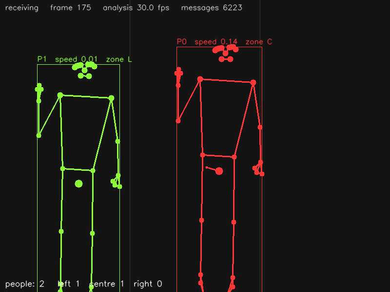

# Body landmarks — Python

_Castellano:_ recibe por OSC los 33 puntos del cuerpo que manda
`mediapipe_osc.py --pose`, dibuja el esqueleto de cada persona con su id, en qué
tercio de la imagen está y si levanta una mano.  `python body_landmarks.py`
(y en otra terminal `python ../../mediapipe_osc.py --pose`).

Receives the **Body** detector (`/mp/pose/...`) and draws, for every person:
the skeleton (33 landmarks joined by MediaPipe's connections, brighter points
when more visible), the bounding box, the centre with a velocity arrow, the id,
the third of the picture the person stands in (left / centre / right) and a
"HAND UP!" flag when a wrist is above the shoulders.



## Install

```
pip install python-osc opencv-python numpy      # or: pip install -r ../requirements.txt
```

## Run

```
# terminal 1: the camera
python ../../mediapipe_osc.py --pose --mirror

# terminal 2: this example
python body_landmarks.py                 # listens on port 5005
python body_landmarks.py --port 9000     # another port (start the app with --port 9000)
```

`q` or `Esc` closes the window.  Without a camera: `python ../../osc_simulator.py`
in terminal 1.  `python body_landmarks.py --headless --seconds 5` runs without a
window and prints what arrived (that is what `make test` does).

## Messages used

| address | arguments | |
|---------|-----------|-|
| `/mp/pose/enter` | `id` | a new person |
| `/mp/pose/leave` | `id` | gone |
| `/mp/pose/center` | `id x y z` | centre of the body (visibility-weighted) |
| `/mp/pose/bbox` | `id xmin ymin xmax ymax` | |
| `/mp/pose/velocity` | `id vx vy speed` | normalized units per second |
| `/mp/pose/landmarks` | `id` + 33 × `x y z visibility` | the skeleton |

`x`, `y` are 0..1 (origin top-left); landmarks outside the picture are
extrapolated and can be < 0 or > 1.  The landmark numbering is MediaPipe's:
0 nose, 11/12 shoulders, 13/14 elbows, 15/16 wrists, 23/24 hips, 25/26 knees,
27/28 ankles ([full list](https://developers.google.com/mediapipe/solutions/vision/pose_landmarker)).

## Where to start changing it

* `Person.zone()` — the "where is the visitor" logic (three columns).  Change
  `3` for finer zones, or use `center[1]` for rows.
* `Person.hand_raised()` — a gesture made from landmarks: compare any two
  points the same way (hands together, crouching = hips low, ...).
* `draw()` — replace the skeleton by your own graphics; `to_px()` converts the
  normalized coordinates to window pixels.
* `on_enter` / `on_leave` — start and stop sounds or animations per person.
