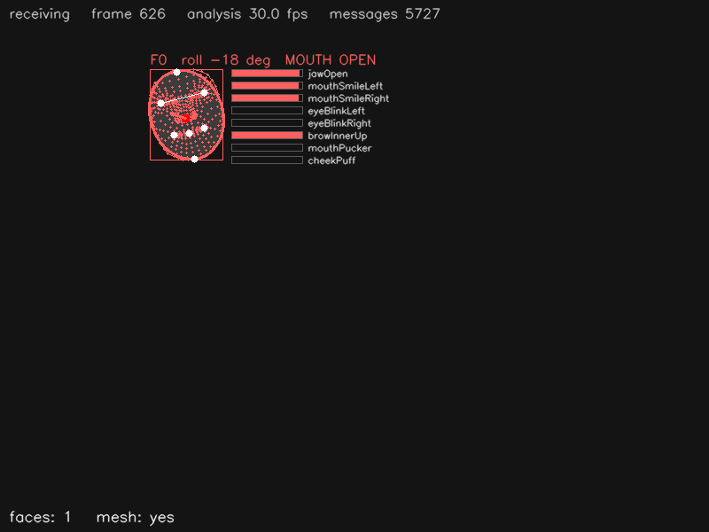

# Face landmarks — Python

_Castellano:_ recibe por OSC las caras que manda
`mediapipe_osc.py --face --face-landmarks`: caja, punta de la nariz, malla de
478 puntos, 52 *blendshapes* (boca abierta, sonrisa, parpadeo...) y dibuja una
"máscara" orientada con la inclinación de la cabeza, donde una instalación
pondría su propia imagen.  `python face_landmarks.py`
(y en otra terminal `python ../../mediapipe_osc.py --face --face-landmarks`).

Receives the **Face** detector (`/mp/face/...`) and draws, for every face: the
bounding box, the nose tip, the 478-point mesh and the face oval (when the app
sends the mesh), the head roll computed from the outer eye corners, an
ellipse "mask" placed and rotated over the face — where an installation would
draw its own image, a bird's head for instance — and bars for the most
expressive blendshapes (`jawOpen`, `mouthSmileLeft/Right`, `eyeBlinkLeft/Right`,
`browInnerUp`, `mouthPucker`, `cheekPuff`).  Opening the mouth is printed as an event.



## Install

```
pip install python-osc opencv-python numpy      # or: pip install -r ../requirements.txt
```

## Run

```
# terminal 1: the camera.  --face-landmarks adds the 478-point mesh (a 7 KB message per face)
python ../../mediapipe_osc.py --face --face-landmarks --mirror

# terminal 2: this example
python face_landmarks.py                 # listens on port 5005
python face_landmarks.py --port 9000
```

Without `--face-landmarks` the example still works (box, nose, blendshapes,
mask without roll); the bottom line of the window says whether the mesh arrives.
`q` or `Esc` closes the window.  Without a camera: `python ../../osc_simulator.py`.
`--headless --seconds 5` runs without a window (used by `make test`).

## Messages used

| address | arguments | |
|---------|-----------|-|
| `/mp/face/enter`, `/mp/face/leave` | `id` | |
| `/mp/face/center` | `id x y z` | the nose tip |
| `/mp/face/bbox` | `id xmin ymin xmax ymax` | |
| `/mp/face/velocity` | `id vx vy speed` | |
| `/mp/face/blendshapes` | `id` + 52 × `value` | 0..1, in the order of `blendshape_names` |
| `/mp/face/blendshape_names` | 52 × `name` | sent once when the app starts |
| `/mp/face/landmarks` | `id` + 478 × `x y z` | only with `--face-landmarks` |

Useful mesh indices: 1 nose tip, 10 forehead, 152 chin, 33 / 263 outer eye
corners, 61 / 291 mouth corners, 13 / 14 upper / lower lip
([map](https://developers.google.com/mediapipe/solutions/vision/face_landmarker)).
The blendshape names are the 52 ARKit ones (`jawOpen`, `eyeBlinkLeft`,
`mouthSmileRight`, ...).

## Where to start changing it

* the "mask" in `draw()`: replace the ellipse by `cv2.warpAffine` of your own
  image, centred on the box, scaled to its size and rotated by
  `Face.roll_degrees()`.
* `MOUTH_OPEN` / `on_blendshapes` — events from expressions: a smile
  (`mouthSmileLeft + mouthSmileRight`), a blink, raised brows...
* `Face.value(name)` gives any blendshape by name; `SHOWN_BLENDSHAPES` picks
  the bars.
