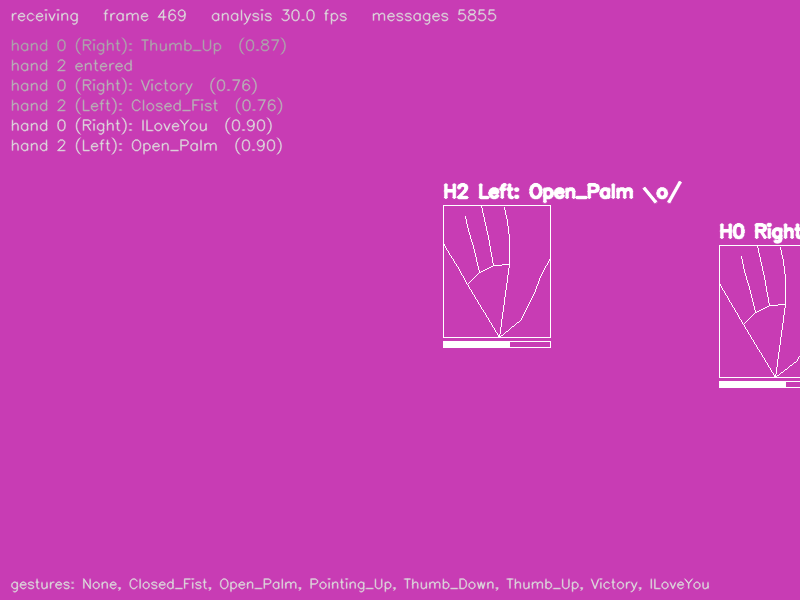

# Hand gestures — Python

_Castellano:_ recibe por OSC los gestos de mano que manda
`mediapipe_osc.py --gesture` (puño, palma abierta, pulgar arriba, victoria...)
y los convierte en eventos: cada cambio de gesto se registra, cada gesto tiñe
el fondo de un color y un pulgar arriba hace un flash.  `python hand_gestures.py`
(y en otra terminal `python ../../mediapipe_osc.py --gesture`).

Receives the **Gestures** detector (`/mp/hand/gesture`, plus the hand
messages) and shows the recognised gesture of every hand with its score bar.
The useful part for an installation is turning the stream of gestures (one
per frame) into *events*: the example logs every gesture **change**, tints the
background with a colour per gesture and flashes the screen on a `Thumb_Up`.



The eight gestures of MediaPipe's recogniser: `None`, `Closed_Fist`,
`Open_Palm`, `Pointing_Up`, `Thumb_Down`, `Thumb_Up`, `Victory`, `ILoveYou`.

## Install

```
pip install python-osc opencv-python numpy      # or: pip install -r ../requirements.txt
```

## Run

```
# terminal 1: the camera  (--gesture implies --hands)
python ../../mediapipe_osc.py --gesture --mirror

# terminal 2: this example
python hand_gestures.py                  # listens on port 5005
python hand_gestures.py --port 9000
```

`q` or `Esc` closes the window.  Without a camera: `python ../../osc_simulator.py`
(the simulated hands change gesture every two seconds).
`--headless --seconds 5` runs without a window (used by `make test`).

## Messages used

| address | arguments | |
|---------|-----------|-|
| `/mp/hand/gesture` | `id name score` | every frame, per hand |
| `/mp/hand/enter`, `/mp/hand/leave` | `id` | |
| `/mp/hand/info` | `id handedness score` | |
| `/mp/hand/center`, `/mp/hand/bbox` | `id x y z`, `id xmin ymin xmax ymax` | |
| `/mp/hand/landmarks` | `id` + 21 × `x y z` | drawn as a thin outline |

## Where to start changing it

* `on_gesture` — the event logic.  `MIN_SCORE` filters doubtful
  classifications; a gesture that must be *held* for a while before it counts
  is a timer away (store the time of the change and compare in `draw`).
* `GESTURES` — one colour / icon per gesture; map them to sounds, scenes,
  lights...
* The gesture comes with the hand's `center` and `handedness`, so "Open_Palm
  with the left hand on the right side of the picture" is a simple `if`.
