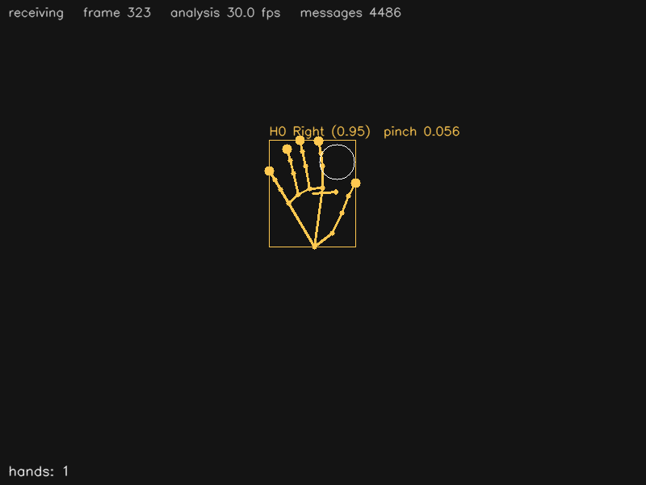

# Hand landmarks — Python

_Castellano:_ recibe por OSC las manos que manda `mediapipe_osc.py --hands`:
21 puntos por mano, izquierda/derecha, y la distancia entre pulgar e índice
(pinza), que se usa como evento.  `python hand_landmarks.py`
(y en otra terminal `python ../../mediapipe_osc.py --hands`).

Receives the **Hands** detector (`/mp/hand/...`) and draws every hand: the 21
landmarks with their connections, the fingertips bigger, a colour per
handedness (Left / Right), the bounding box, the velocity arrow and the pinch
— the distance between the thumb tip and the index tip — as a circle that is
filled while the fingers are "pinching".  The pinch closing / opening is printed
as an event.



## Install

```
pip install python-osc opencv-python numpy      # or: pip install -r ../requirements.txt
```

## Run

```
# terminal 1: the camera
python ../../mediapipe_osc.py --hands --mirror

# terminal 2: this example
python hand_landmarks.py                 # listens on port 5005
python hand_landmarks.py --port 9000
```

`q` or `Esc` closes the window.  Without a camera: `python ../../osc_simulator.py`.
`--headless --seconds 5` runs without a window (used by `make test`).

## Messages used

| address | arguments | |
|---------|-----------|-|
| `/mp/hand/enter`, `/mp/hand/leave` | `id` | |
| `/mp/hand/info` | `id handedness score` | `"Left"` / `"Right"` (with `--mirror`, as the viewer sees them) |
| `/mp/hand/center` | `id x y z` | |
| `/mp/hand/bbox` | `id xmin ymin xmax ymax` | |
| `/mp/hand/velocity` | `id vx vy speed` | |
| `/mp/hand/pinch` | `id distance` | thumb tip – index tip, roughly metres |
| `/mp/hand/landmarks` | `id` + 21 × `x y z` | 0 wrist, 4 thumb tip, 8 index tip, 12, 16, 20 other tips |

## Where to start changing it

* `PINCH_CLOSED` — the threshold of the pinch event (depends on the distance
  to the camera; watch the printed values).
* `on_pinch` — the event: start something when it closes, stop when it opens.
* `FINGERTIPS` / `landmarks[INDEX_TIP]` — use a fingertip as a cursor: draw
  where it points, or check whether it is inside a region of the window.
* Two hands: `hands` holds all of them; the distance between two `center`s
  is a simple "stretch" control.
